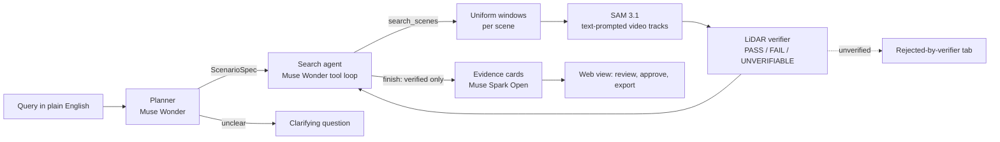

# LongTail

**Find the rare driving moments that break self-driving cars, and prove they are real.**

An engineer types a rare scenario in plain English ("a pedestrian crossing in front of us while we move") and gets back the moments in multi-camera driving logs that contain it. Every claim a model makes about those moments is checked against a second sensor, LiDAR, before it counts. The model proposes; geometry decides.

> **Status (Nov 2, 2026): built, not yet run on real data.** Every part below exists and is tested on a synthetic scene with scripted models. The first runs on PandaSet with the Meta models are pending (data download and API keys). Numbers appear in this README only after they are measured; until then each says *not measured yet*.

## How it works



1. **Plan.** Muse Wonder turns the query into a `ScenarioSpec` (actors, predicates, stated defaults such as "near = within 5 m") through one forced tool call. The spec is validated by the contract and by semantic checks, with errors sent back for a retry, or the planner asks one clarifying question.
2. **Search.** A budgeted agent on Wonder lists scenes, searches them, and finishes. Stop rule: `finish`, 6 model calls, or the query budget. Every step is in a trace.
3. **See.** SAM 3.1 segments and tracks the named objects through each camera's video from a text prompt.
4. **Verify.** Our code projects LiDAR into the cameras, keeps the points inside each mask, removes ground and background, clusters them, builds 3D tracks with speeds and the ego's future corridor, and evaluates each predicate per sweep as **PASS**, **FAIL** or **UNVERIFIABLE** with evidence (point counts, distances, speeds, reason codes). `verified` is computed from the results; nothing can set it.
5. **Explain.** Muse Spark Open writes a short card for a finding. A validator rejects any sentence that cites nothing, states a FAIL or UNVERIFIABLE result as fact, or uses a number not in its evidence; after one retry the card falls back to a template, so a card never carries an unverified claim.
6. **Review.** The web view shows the trace, the verified findings, everything the verifier rejected and why, and a detail page with six-camera overlays, a bird's-eye view and a per-sweep predicate strip. A human approves or rejects; approved findings export as JSON or CSV.

## Models

| Model | Job here | Where |
|---|---|---|
| Muse Wonder | Planner and search agent | `longtail/agent/` |
| SAM 3.1 | Text-prompted video segmentation and tracking | `longtail/vision/` |
| Muse Spark Open (open weights, on Baseten) | Evidence cards; ablation baseline (a), "describe then match" | `longtail/explain/`, `longtail/eval/baseline_vlm.py` |

Muse Glimmer triage was planned and cut for time (configuration (d) of the ablation is not run); the agent searches uniform 4 s windows instead.

## Evaluation

25 queries in three tiers (single object, behaviour, relational), split 10 development / 15 held-out by a seeded random draw within each tier (`longtail/eval/queries/queries.yaml`). Ground truth comes from the dataset's 3D labels by a script, reached only inside a label guard that the pipeline cannot open. Held-out queries are run once, at the end.

| Metric | Value |
|---|---|
| Precision@10, held-out | *not measured yet* |
| Recall over ground-truth events, held-out | *not measured yet* |
| Hallucination-catch rate (model claims the labels show are false, caught by the verifier) | *not measured yet* |
| False-rejection rate (true claims the verifier rejected) | *not measured yet* |
| Cost and seconds per query | *not measured yet* |

Ablation: (a) Spark Open alone, (b) plus SAM 3.1 tracks, (c) plus LiDAR verification. Deliberate breaks (verifier off, calibration shifted 2° and 0.3 m, LiDAR offset 200 ms) must lower precision or the catch rate; a break that does not is reported as a hole in the evaluation. Each number gets a 95% bootstrap interval over queries.

## Run it

```bash
uv sync                                    # Python 3.11, dependencies pinned in uv.lock
cp .env.example .env                       # your own keys; paid calls stay off until LONGTAIL_ALLOW_PAID=1
uv run pytest                              # synthetic scene only: no dataset, no keys, no network
```

Data: PandaSet (all 103 sequences, about 44.5 GB) into `$LONGTAIL_DATA_DIR/pandaset/` (see `scripts/download_data.sh`), then `uv run python scripts/build_index.py`.

```bash
uv run longtail plan "a cyclist within 15 m"                 # the spec only
uv run longtail search "a pedestrian crossing in front of us while we move"
uv run longtail card runs/<run> <finding_id> [--template]   # one evidence card
uv run longtail costs --markdown                            # spend by model, from runs/ledger.jsonl

cd web && npm install && npm run build && cd ..
LONGTAIL_MODE=replay uv run uvicorn api.server:create_app_from_env --factory --port 8000
```

`LONGTAIL_MODE=replay` serves every model call from the cache, so a recorded demo replays exactly with no key. `LONGTAIL_MODE=offline-demo` runs the web view on synthetic scenes with a scripted model, for development only; it shows a banner and is never used for results or footage.

## Honesty rules we hold ourselves to

- The pipeline never reads labels: a label guard raises outside `eval_ground_truth()`, and a test enforces where that context may be used.
- Every paid call goes through one client with a cache, a ledger, a per-query budget, a spend cap and a gate that is off by default.
- Every choice the plan did not fix is registered in `docs/assumptions.md` and tagged in the code.
- We never stage a hallucination for the video: if none is caught, the video shows the measured rate.
- Past tense only for what ran; this README is updated as results land.

## Dataset and credit

PandaSet by Hesai and Scale AI, licensed under CC BY 4.0 (https://creativecommons.org/licenses/by/4.0/). Frames are shown with LiDAR, mask and box overlays added by LongTail. Dataset files are never committed.

## Built during the hackathon

All code here was written during the build window (Meta Global AI Developer Hackathon, Oct 26 to Nov 4, 2026); see [docs/build-log.md](docs/build-log.md) and the commit history. Status per task: [docs/status-chethan.md](docs/status-chethan.md), [docs/status-mayank.md](docs/status-mayank.md).

## Team

Mayank Bhadrasen (agent, models, product) and Chethan (perception and verification).

## Licence

Apache-2.0 for the code.
