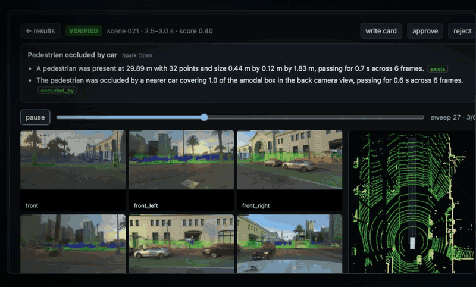
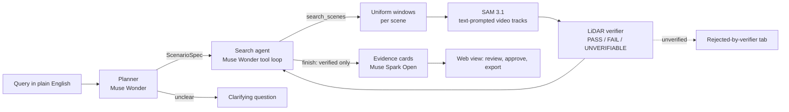
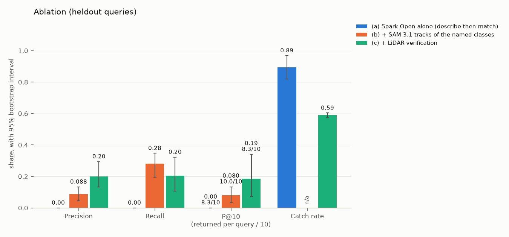

# LongTail

**Type a rare driving scenario in plain English. Get back the moments in hours of multi-camera logs that contain it, each one checked against LiDAR before you see it.**



*A real finding from the recorded demo run: the evidence card cites its measurements, the six cameras and the bird's-eye view show the LiDAR points, and the predicate strip shows the checks for each sweep. Replaying it costs nothing.*

The model proposes, and geometry decides.

---

## Why we built it

Self-driving cars are trained and tested on the **long tail**: a pedestrian half hidden by a parked car, a cyclist cutting across, a car reversing out of a driveway. These moments are rare, they matter most, and they're buried in hours of logs from six cameras and a LiDAR.

Vision-language models can search video, but they say "yes" far too easily. On our 15 held-out queries, **96% of the claims a vision model made on its own were false** (375 of 391; `longtail/eval/runs/all-heldout/results/ablation_a.json`). A safety test set that holds a pedestrian who was never there costs real money and engineering time.

LongTail grounds every claim in a second sensor. It tracks objects with SAM 3.1, then checks each track against the LiDAR. Only findings that pass are shown, and the rest go to a "rejected by verifier" tab with the reason.

## Who it's for

- **AV and robotics data engineers** who mine logs for rare scenarios to train on.
- **Safety-validation and test teams** who build scenario suites and need each clip to be what it claims.
- **Eval and dataset curators** who want labelled events with evidence attached, not a model's say-so.
- **Researchers** who study grounding and hallucination in vision-language models, with an evaluation that can fail.

## What it does



1. **Plan.** Muse Wonder turns the query into a `ScenarioSpec` (actors, predicates, and stated defaults such as "near = within 5 m") through one tool call. The spec is checked by the contract and by semantic checks, and any error goes back for a retry. If the query is unclear, the planner asks one clarifying question instead.
2. **Search.** A budgeted agent on Wonder lists scenes, searches them and finishes. It stops on `finish`, after 6 model calls, or at the query budget. Every step is in a trace.
3. **See.** SAM 3.1 segments and tracks the named objects through each camera's video from a text prompt.
4. **Verify.** Our code does the following, then scores each predicate per sweep as **PASS**, **FAIL** or **UNVERIFIABLE**:
   - projects the LiDAR into the cameras and keeps the points inside each mask;
   - removes ground and background, and clusters what's left;
   - builds 3D tracks with speeds, plus the ego car's future corridor.

   Each result carries evidence: point counts, distances, speeds and reason codes. `verified` is computed from the results, and nothing can set it.
5. **Explain.** Muse Spark Open writes a short evidence card. A validator rejects any sentence that cites nothing, states a FAIL or UNVERIFIABLE result as fact, or uses a number not in its evidence. After one retry the card falls back to a template, so a card never carries an unverified claim.
6. **Review.** The web view shows:
   - the trace and the verified findings;
   - everything the verifier rejected, and why;
   - a detail page with six-camera overlays, a bird's-eye view and a per-sweep predicate strip.

   A human approves or rejects each finding, and approved findings export as JSON or CSV.

### The Meta models

| Model | Job here | Where |
|---|---|---|
| Muse Wonder | Planner and search agent | `longtail/agent/` |
| SAM 3.1 | Text-prompted video segmentation and tracking | `longtail/vision/` |
| Muse Spark Open (open weights, on Baseten) | Evidence cards; ablation baseline (a), "describe then match" | `longtail/explain/`, `longtail/eval/baseline_vlm.py` |

Muse Glimmer triage was planned and cut for time (A-213), so configuration (d) of the ablation isn't run. The agent searches uniform 4 s windows instead.

## Results

All results are on held-out data: 15 queries, 102 PandaSet scenes, 95% bootstrap intervals over queries. The 102 scenes are all 103 except scene 054, whose camera timestamps are broken (A-240). The full tables are in [docs/eval-report.md](docs/eval-report.md).

| Configuration | Precision | Recall | P@10 | False claims caught | True claims wrongly rejected |
|---|---|---|---|---|---|
| (a) Muse Spark Open alone | 0.00 | 0.00 | 0.00 | n/a | n/a |
| (b) + SAM 3.1 tracks | 0.088 [0.044, 0.134] | 0.28 [0.19, 0.35] | 0.080 [0.033, 0.133] | n/a | n/a |
| **(c) + LiDAR verification (headline, v1)** | **0.20 [0.13, 0.29]** | **0.20 [0.11, 0.32]** | **0.19 [0.07, 0.34]** | **0.59 [0.57, 0.60]** | **0.46 [0.44, 0.48]** |
| (c) v2: the real-data fixes | 0.18 [0.13, 0.28] | 0.24 [0.14, 0.37] | 0.24 [0.11, 0.39] | 0.59 [0.57, 0.60] | 0.46 [0.44, 0.48] |



**What the numbers say, and what they don't:**
- **Precision:** LiDAR verification raises it from 0.088 to 0.20. Over 15 queries the two intervals touch, so the gain isn't clearly significant.
- **Separation:** the verifier catches 59% of the remaining false claims, but it also wrongly rejects 46% of true ones. It's strict, and it separates false from true claims only weakly.
- **Recall:** it drops from 0.28 to 0.20. That's the price of the precision.
- **v2:** the real-data checks found three problems: thin masks read as FAIL, jittery tracks, and SAM's 16-object cap per response (A-245 to A-248). We fixed them as v2. The changes, the settings and the rule for which version leads were tagged `v2-prereg` before any v2 run, and v2 was run once. It raised recall from 0.20 to 0.24 (152 of 626 events, against 128) and P@10 from 0.19 to 0.24, at a small cost in precision (0.20 to 0.18). The rule required raising precision or recall without lowering the other, so **v1 stays the headline**. Set `LONGTAIL_VERIFIER=v2` to use v2.
- **Deliberate breaks:** we broke the system three ways:
  - the verifier turned off;
  - the calibration shifted 2° and 0.3 m;
  - the LiDAR offset by 200 ms.

  Each break lowered precision or recall on every split, so the evaluation can detect a broken verifier.
- **Cost:** the whole project's paid calls, the full evaluation included, came to about $68. See [docs/costs.md](docs/costs.md).

The 25 queries come in three tiers: single object, behaviour and relational. A seeded random draw within each tier split them 10 development / 15 held-out (`longtail/eval/queries/queries.yaml`). Ground truth comes from the dataset's 3D labels, computed by a script inside a label guard that the pipeline can't open. Held-out queries were run once, at the end.

---

## Get started

Pick the path you need:

| Path | What you get | Needs | Time |
|---|---|---|---|
| **1. Tests only** | The full test suite on a synthetic scene | Nothing: no data, keys or network | Minutes |
| **2. Replay the demo** | The web view of the recorded search: findings, cameras, bird's-eye view, cards | The 29 index scenes (about 13 GB) and the replay cache (about 240 MB). No key, no paid call | About 30 to 60 min, mostly the download |
| **3. Live** | New searches with your own queries | Your own Meta Model API and Baseten keys, plus the data from path 2 | About 5 to 6 min of verification per scene searched |

### Prerequisites

| Tool | Version | Why |
|---|---|---|
| [uv](https://docs.astral.sh/uv/) | recent | Installs Python 3.11 (`.python-version`) and the locked dependencies (`uv.lock`) |
| Python | 3.11 | Installed by uv; you don't need a system Python |
| Node.js and npm | 18 or newer (tested with 24) | Builds the web view (React 18, Vite 5) |
| ffmpeg | any recent | Builds the per-camera clip videos from the dataset images |
| git | any recent | Clones the repo and the pinned PandaSet devkit dependency |
| Disk | about 14 GB free | The 29 index scenes (about 13 GB), the labels for all 103 scenes (0.12 GB), and the cache |

### macOS (tested)

```bash
# 1. Tools (Homebrew: https://brew.sh)
brew install uv node ffmpeg git

# 2. Code and dependencies
git clone https://github.com/Mayank-1024/longtail.git
cd longtail
uv sync

# Path 1: tests only (synthetic scene; no dataset, keys or network)
uv run pytest

# Path 2: replay the recorded demo (no key, no paid call)
(cd web && npm install && npm run build)
S=$(uv run python -c "from longtail.data.index import load_index; print(','.join(s['scene_id'] for s in load_index()['scenes']))")
uv run python scripts/fetch_pandaset.py --parts full --scenes $S   # the 29 index scenes, about 13 GB
uv run longtail demo --fetch-cache                               # the recorded run's cache (GitHub release asset, sha256-checked)
uv run longtail demo --list                                      # the recorded search and its verified findings
uv run longtail demo --replay                                    # open http://127.0.0.1:8000
```

### Windows

LongTail is developed and tested on macOS, and Windows is **untested**. We checked the code for the usual POSIX-only traps:
- The Python code doesn't use `fcntl`, `os.fork` or `signal`.
- The parallel SAM step uses a process pool with the `spawn` start method, which is also the macOS default, so it runs the same way on both.
- Cache keys are built from clip IDs, not file paths.
- The only shell scripts (`scripts/*.sh`, `scripts/explorer/`) are developer and cluster tools that the paths below don't need.

We know of no blocker, but we haven't run it on Windows. **WSL2 is the route we recommend**, because inside it everything is the tested Linux and macOS setup.

**Option A: WSL2 (recommended).** In PowerShell as administrator:

```powershell
wsl --install -d Ubuntu
```

Restart if asked, open **Ubuntu** from the Start menu, then:

```bash
sudo apt update && sudo apt install -y ffmpeg git curl
curl -LsSf https://astral.sh/uv/install.sh | sh && source ~/.bashrc
curl -fsSL https://deb.nodesource.com/setup_20.x | sudo -E bash - && sudo apt install -y nodejs
git clone https://github.com/Mayank-1024/longtail.git && cd longtail
uv sync
```

Then run the same commands as the macOS paths above. Clone inside the Linux home directory (`~/`), not under `/mnt/c/`, because file access there is much faster. Open http://127.0.0.1:8000 in your Windows browser: WSL2 forwards localhost.

**Option B: native PowerShell (untested).**

```powershell
# 1. Tools (open a new terminal afterwards so PATH picks them up)
winget install astral-sh.uv
winget install OpenJS.NodeJS.LTS
winget install Gyan.FFmpeg
winget install Git.Git

# 2. Code and dependencies
git clone https://github.com/Mayank-1024/longtail.git
cd longtail
uv sync

# Path 1: tests only
uv run pytest

# Path 2: replay the recorded demo
cd web; npm install; npm run build; cd ..
$S = uv run python -c "from longtail.data.index import load_index; print(','.join(s['scene_id'] for s in load_index()['scenes']))"
uv run python scripts/fetch_pandaset.py --parts full --scenes $S
uv run longtail demo --fetch-cache
uv run longtail demo --list
uv run longtail demo --replay      # open http://127.0.0.1:8000
```

If something breaks on native Windows, please open an issue, and use WSL2 in the meantime.

### What the replay does

The first replay rebuilds the clip videos from the camera images, which takes ffmpeg a few minutes. After that, every model and SAM call is served from the cache. A cache miss is an error, never a charge.

The web view opens the recorded search at once, and its six-camera and bird's-eye views are rebuilt from the images on first view. `uv run longtail demo --replay --query` reruns the recorded search headless in minutes, because `longtail demo` loads each scene's recorded LiDAR verification from `runs/` (A-243) instead of redoing it.

Replay covers the **recorded query** only: a different query has nothing recorded, so it stops with a cache miss. Use path 3 for new queries.

### Path 3: live mode, with your own keys

Live mode makes real, paid calls: Muse Wonder and SAM 3.1 on the Meta Model API, and Muse Spark Open on Baseten. Paid calls stay **off** until you turn them on, and every call is gated, cached, budgeted and logged.

1. Copy the template and add your keys. The file is git-ignored; never commit it.
   - macOS / WSL2: `cp .env.example .env`
   - PowerShell: `Copy-Item .env.example .env`

   Set `MODEL_API_KEY` (Meta Model API) and `BASETEN_API_KEY` (Muse Spark Open). The Modal entries aren't needed, since Glimmer was cut.
2. Turn paid calls on and set a hard cap, in `.env` or the shell:

   ```bash
   # macOS / WSL2
   export LONGTAIL_ALLOW_PAID=1 LONGTAIL_SPEND_CAP_USD=5 LONGTAIL_MODE=live
   ```
   ```powershell
   # PowerShell
   $env:LONGTAIL_ALLOW_PAID = "1"; $env:LONGTAIL_SPEND_CAP_USD = "5"; $env:LONGTAIL_MODE = "live"
   ```
3. Start small, then search:

   ```bash
   uv run longtail plan "a cyclist within 15 m"           # the spec only: one Wonder call, cents
   uv run longtail search "a pedestrian crossing in front of us while we move"
   uv run longtail card runs/<run> <finding_id>           # one evidence card (about $0.004)
   uv run longtail costs --markdown                       # what you've spent, by model
   ```
   Or use the web view in live mode:
   - macOS / WSL2: `LONGTAIL_MODE=live uv run uvicorn api.server:create_app_from_env --factory --port 8000`
   - PowerShell: `uv run uvicorn api.server:create_app_from_env --factory --port 8000`, after setting `$env:LONGTAIL_MODE = "live"`

**What it costs.**
- SAM 3.1 is listed at $0.016 per 80-frame camera clip ($0.20 per 1,000 frames).
- At list price with nothing cached, a query over all 102 scenes is about $12.50. In practice it's much less, because the agent searches fewer scenes and responses are cached and shared across queries.
- `LONGTAIL_QUERY_BUDGET_USD` caps each query's model calls, and `LONGTAIL_SPEND_CAP_USD` is a hard cap over everything in `runs/ledger.jsonl`. A call that would cross either cap is refused.
- Verification runs on your machine and takes about 5 to 6 minutes a scene with 4 workers.

### Configuration

| Variable | Default | What it does |
|---|---|---|
| `LONGTAIL_MODE` | `replay` (web server) | `live`, `replay` (every call from the cache) or `offline-demo` (synthetic scenes and a scripted model, for development only; shows a banner) |
| `LONGTAIL_ALLOW_PAID` | `0` | `1` allows real, paid calls |
| `LONGTAIL_SPEND_CAP_USD` | `5` | Hard cap over the ledger |
| `LONGTAIL_QUERY_BUDGET_USD` | `0.75` | Model-call budget per query |
| `LONGTAIL_REPLAY` | `0` | `1` serves every model call from the cache and fails on a miss |
| `LONGTAIL_DATA_DIR` | `./data` | Where PandaSet lives (`$LONGTAIL_DATA_DIR/pandaset/`) |
| `LONGTAIL_CACHE_DIR` | `cache` | Model responses, SAM responses, parsed tracks, clips |
| `LONGTAIL_RUNS` | `runs` | Searches, per-scene verification runs, the ledger |
| `LONGTAIL_VERIFIER` | `v1` | `v2` selects the pre-registered real-data fixes |
| `LONGTAIL_SAM_WORKERS` | `6` | Parallel SAM cache warming |
| `LONGTAIL_RESUME` | off | `1` loads a scene already verified for the same spec from `runs/` (`longtail demo` sets it) |

**Data:** PandaSet comes from its Hugging Face mirror, fetched by HTTP range request straight into `$LONGTAIL_DATA_DIR/pandaset/`, so there's no 44.5 GB zip to download first.
- `uv run python scripts/fetch_pandaset.py --parts labels` fetches the labels for all 103 scenes (0.12 GB).
- `--parts full --scenes 001,002` fetches whole scenes, about 0.44 GB each.

The 30-scene index (`longtail/data/index.json`) is committed.

---

## Honesty rules we hold ourselves to

- **No labels in the pipeline.** A label guard raises outside `eval_ground_truth()`, and a test enforces where that context may be used.
- **One gate for paid calls.** Every paid call goes through one client with a cache, a ledger, a per-query budget, a spend cap, and a gate that's off by default.
- **Every assumption written down.** Every choice the plan didn't fix is in [docs/assumptions.md](docs/assumptions.md), tagged in the code and checked by a test (`tests/test_assumptions.py`).
- **Nothing staged.** We never stage a hallucination for the video: the demo replays a real recorded run, call for call.
- **Changes registered before results.** v2's changes and the rule for which version leads were tagged before v2 was run, and both versions are reported.

## Dataset and credit

SAM 3.1 by Meta is used under the [SAM License](https://github.com/facebookresearch/sam3/blob/main/LICENSE) (last updated November 19, 2025). LongTail calls SAM 3.1 through Meta's hosted API and doesn't include or redistribute its weights or code. The replay cache published with the demo holds only SAM's outputs (masks and tracks) for PandaSet clips.

PandaSet by Hesai and Scale AI is licensed under CC BY 4.0 (https://creativecommons.org/licenses/by/4.0/). Frames are shown with LiDAR, mask and box overlays added by LongTail, including in the GIF above. Dataset files are never committed.

## Built during the Meta Global AI Developer Hackathon

All the code here was written during the build window of the **Meta Global AI Developer Hackathon** (Oct 26 to Nov 4, 2026). See [docs/build-log.md](docs/build-log.md) and the public commit history. The status of each task is in [docs/status-chethan.md](docs/status-chethan.md) and [docs/status-mayank.md](docs/status-mayank.md).

## Team

| | |
|---|---|
| **Mayank Bhadrasen** | The agent and planner, the model clients and evidence cards, the API and web view, the evaluation runs, the demo |
| **Chethan Gowda** | Perception and the verification core: the dataset adapter, LiDAR-camera projection and sync, the SAM 3.1 client, mask-to-LiDAR, tracks and the ego path, the verifier, ground truth, the metrics and ablation, the visualization export |

## Licence

The code is licensed under Apache-2.0 ([LICENSE](LICENSE)).
