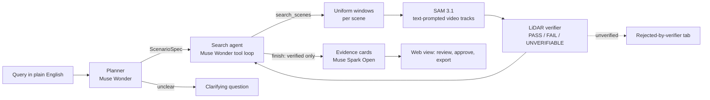

# LongTail

**Find the rare driving moments that break self-driving cars, and prove they are real.**

An engineer types a rare scenario in plain English ("a pedestrian crossing in front of us while we move") and gets back the moments in multi-camera driving logs that contain it. Every claim a model makes about those moments is checked against a second sensor, LiDAR, before it counts. The model proposes; geometry decides.

> **Status (Nov 3, 2026): evaluated.** The full evaluation ran on 102 PandaSet scenes (all 103 but 054, whose camera timestamps are broken; A-240, A-142), with 15 held-out queries run once. Numbers below are measured, each with a 95% bootstrap interval over queries; the full tables are in [docs/eval-report.md](docs/eval-report.md).

## How it works



1. **Plan.** Muse Wonder turns the query into a `ScenarioSpec` (actors, predicates, stated defaults such as "near = within 5 m") through one tool call (the Meta API accepts only `tool_choice: "auto"`, so a reply without a tool call is sent back once more). The spec is validated by the contract and by semantic checks, with errors sent back for a retry, or the planner asks one clarifying question.
2. **Search.** A budgeted agent on Wonder lists scenes, searches them, and finishes. Stop rule: `finish`, 6 model calls, or the query budget. Every step is in a trace.
3. **See.** SAM 3.1 segments and tracks the named objects through each camera's video from a text prompt.
4. **Verify.** Our code projects LiDAR into the cameras, keeps the points inside each mask, removes ground and background, clusters them, builds 3D tracks with speeds and the ego's future corridor, and evaluates each predicate per sweep as **PASS**, **FAIL** or **UNVERIFIABLE** with evidence (point counts, distances, speeds, reason codes). `verified` is computed from the results; nothing can set it.
5. **Explain.** Muse Spark Open writes a short card for a finding. A validator rejects any sentence that cites nothing, states a FAIL or UNVERIFIABLE result as fact, or uses a number not in its evidence; after one retry the card falls back to a template, so a card never carries an unverified claim.
6. **Review.** The web view shows the trace, the verified findings, everything the verifier rejected and why, and a detail page with six-camera overlays, a bird's-eye view and a per-sweep predicate strip. A human approves or rejects; approved findings export as JSON or CSV.

## Models

| Model | Job here | Where |
|---|---|---|
| Muse Wonder | Planner and search agent | `longtail/agent/` |
| SAM 3.1 | Text-prompted video segmentation and tracking | `longtail/vision/` |
| Muse Spark Open (open weights, on Baseten) | Evidence cards; ablation baseline (a), "describe then match" | `longtail/explain/`, `longtail/eval/baseline_vlm.py` |

Muse Glimmer triage was planned and cut for time (configuration (d) of the ablation is not run); the agent searches uniform 4 s windows instead.

## Measured so far

| What | Result |
|---|---|
| Planner (Muse Wonder) against the gold specs, 10 development queries | 10/10 agree; one needed a retry after the semantic check caught an unused actor; $0.27 |
| Planner against the gold specs, 15 held-out queries (run once) | 15/15 agree; two needed retries; $0.38 |
| End to end on PandaSet scene 001: "a car behind us within 10 m" | Wonder planned, SAM 3.1 tracked cars in all 6 cameras, the verifier kept 2 findings and rejected 1; both overlap ground-truth events in time (the first lies inside one, the second overlaps one by 0.2 s; not yet scored by the evaluation's matching rule); $0.14 |
| Evidence card (Muse Spark Open on Baseten) for a verified finding | Passed the validator on the first attempt; $0.004 |
| SAM 3.1 cost | $0.016 per 80-frame camera clip, as listed ($0.20 per 1,000 frames) |

The first real data also caught two bugs that synthetic tests could not: the ego frame was 180 degrees off (forward and left flipped, so "ahead" meant behind), and four queries had no ground-truth events in any of the 103 scenes; they were replaced by a rule written down before counting ([docs/assumptions.md](docs/assumptions.md), A-25 and A-228).

## Evaluation

25 queries in three tiers (single object, behaviour, relational), split 10 development / 15 held-out by a seeded random draw within each tier (`longtail/eval/queries/queries.yaml`). Ground truth comes from the dataset's 3D labels by a script, reached only inside a label guard that the pipeline cannot open. Held-out queries are run once, at the end.

| Metric | Value |
|---|---|
| Precision@10, held-out | 0.19 [0.07, 0.34] with LiDAR verification, against 0.080 with SAM tracks alone and 0.00 for Spark Open alone |
| Recall over ground-truth events, held-out | 0.20 [0.11, 0.32]; 0.28 [0.19, 0.35] without the verifier, which trades recall for precision (0.20 against 0.088) |
| Hallucination-catch rate (model claims the labels show are false, caught by the verifier) | 0.59 [0.57, 0.60] (64,949 of 110,269 false claims) |
| False-rejection rate (true claims the verifier rejected) | 0.46 [0.44, 0.48]: the verifier is strict |
| Cost and seconds per query | $12.50 and 493 s at list price over all 102 scenes, with no caching; our whole spend, evaluation included, was $67.67 |

Ablation: (a) Spark Open alone, (b) plus SAM 3.1 tracks, (c) plus LiDAR verification. Deliberate breaks (verifier off, calibration shifted 2° and 0.3 m, LiDAR offset 200 ms) must lower precision or the catch rate; a break that does not is reported as a hole in the evaluation. Each number gets a 95% bootstrap interval over queries.

All three breaks lowered precision or recall on every split and scene set; none is a hole. Values in brackets are 95% intervals; held-out, 102 scenes. Per-query cost is the list price of every call a query would make over all 102 scenes with nothing cached; the actual spend was far lower because calls are cached and shared across queries.


## Run it

```bash
uv sync                                    # Python 3.11, dependencies pinned in uv.lock
cp .env.example .env                       # your own keys; paid calls stay off until LONGTAIL_ALLOW_PAID=1
uv run pytest                              # synthetic scene only: no dataset, no keys, no network
```

Data: PandaSet from its Hugging Face mirror, straight into `$LONGTAIL_DATA_DIR/pandaset/` without downloading the 44.5 GB zip first: `uv run python scripts/fetch_pandaset.py --parts labels` (all 103 scenes, 0.12 GB), then `--parts full --scenes 001,002` for the scenes you want (about 0.44 GB each). The 30-scene index is committed (`longtail/data/index.json`).

```bash
uv run longtail plan "a cyclist within 15 m"                 # the spec only
uv run longtail search "a pedestrian crossing in front of us while we move"
uv run longtail card runs/<run> <finding_id> [--template]   # one evidence card
uv run longtail costs --markdown                            # spend by model, from runs/ledger.jsonl

cd web && npm install && npm run build && cd ..
LONGTAIL_MODE=replay uv run uvicorn api.server:create_app_from_env --factory --port 8000
```

`LONGTAIL_MODE=replay` serves every model call from the cache, so a recorded demo replays exactly with no key. `LONGTAIL_MODE=offline-demo` runs the web view on synthetic scenes with a scripted model, for development only; it shows a banner and is never used for results or footage.

## Honesty rules we hold ourselves to

- The pipeline never reads labels: a label guard raises outside `eval_ground_truth()`, and a test enforces where that context may be used.
- Every paid call goes through one client with a cache, a ledger, a per-query budget, a spend cap and a gate that is off by default.
- Every choice the plan did not fix is registered in `docs/assumptions.md` and tagged in the code.
- We never stage a hallucination for the video: if none is caught, the video shows the measured rate.
- Past tense only for what ran; this README is updated as results land.

## Dataset and credit

SAM 3.1 by Meta is used under the [SAM License](https://github.com/facebookresearch/sam3/blob/main/LICENSE) (last updated November 19, 2025). LongTail calls SAM 3.1 through Meta's hosted API and does not include or redistribute its weights or code; the replay cache published with the demo holds only SAM's outputs (masks and tracks) for PandaSet clips.

PandaSet by Hesai and Scale AI, licensed under CC BY 4.0 (https://creativecommons.org/licenses/by/4.0/). Frames are shown with LiDAR, mask and box overlays added by LongTail. Dataset files are never committed.

## Built during the hackathon

All code here was written during the build window (Meta Global AI Developer Hackathon, Oct 26 to Nov 4, 2026); see [docs/build-log.md](docs/build-log.md) and the commit history. Status per task: [docs/status-chethan.md](docs/status-chethan.md), [docs/status-mayank.md](docs/status-mayank.md).

## Team

Mayank Bhadrasen (agent, models, product) and Chethan (perception and verification).

## Licence

Apache-2.0 for the code.
